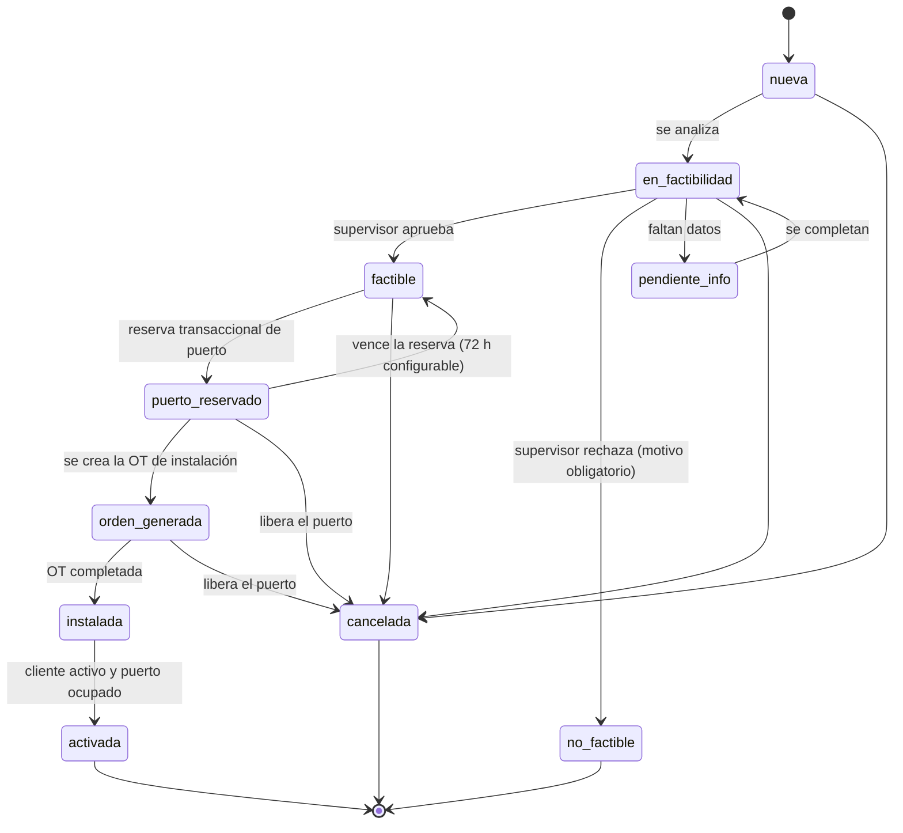
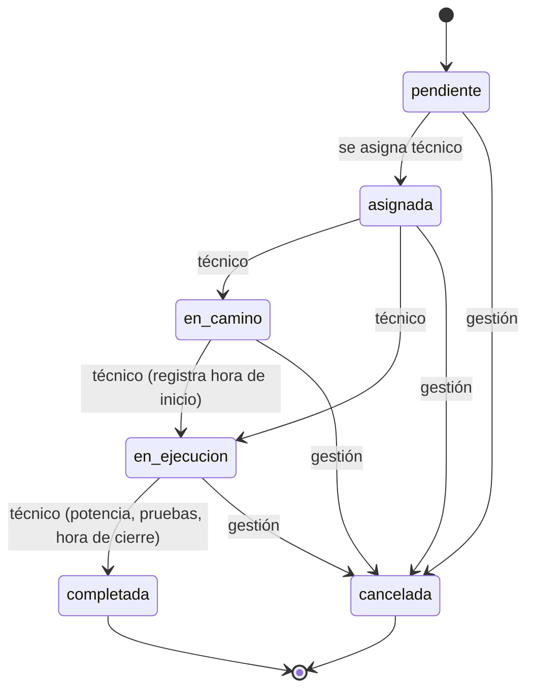
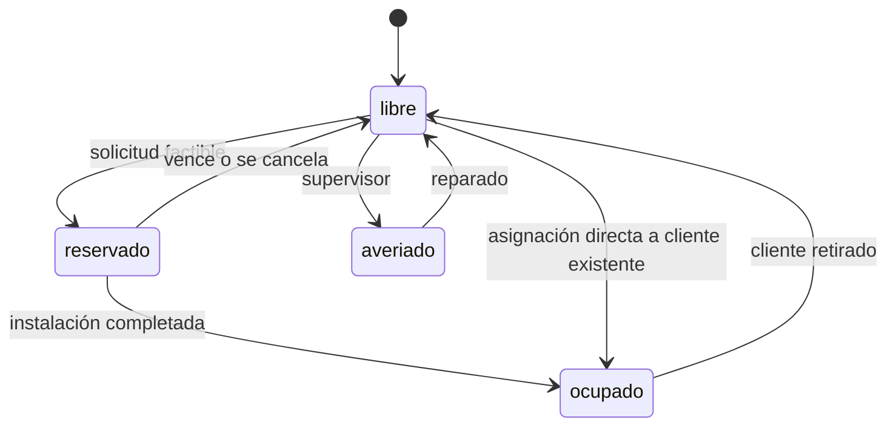

# Estados y flujos

## Solicitud de instalación

La factibilidad es una **recomendación** basada en los datos registrados (NAP cercanas, puertos libres, ruta hasta la OLT, distancia, presupuesto óptico). La decisión la toma una persona.

## Orden de trabajo

Desde la Etapa 1 la base de datos ya garantiza que: una orden en estado distinto de *pendiente* o *cancelada* tiene técnico; al pasar a *en ejecución* se registra la hora de inicio; al completarse o cancelarse se registra la hora de cierre; y un técnico no puede cancelar, reasignar ni reabrir una orden cerrada.

## Puerto de NAP

## Cliente

`pendiente → activo → suspendido ⇄ activo → retirado`. Cada cambio queda en el historial del cliente y en la auditoría.
