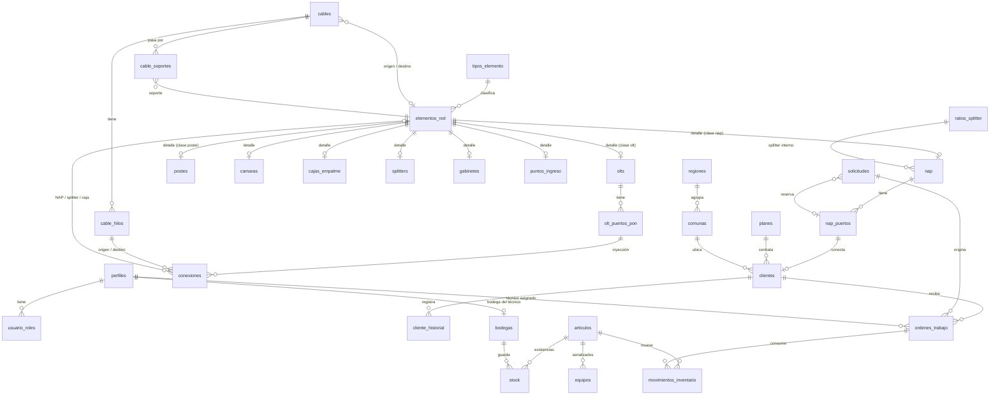

# Modelo de datos

Base PostgreSQL 15 (Supabase) con PostGIS. Coordenadas en SRID 4326 (WGS84) con tipo `geography`, de modo que distancias y longitudes salen en metros. Las migraciones están en `supabase/migrations/` y se aplican en orden.

## Arquitectura de la red modelada

```
OLT (puerto PON) ──inyección──▶ hilo del troncal ──alimentación──▶ NAP (splitter interno) ──puerto──▶ cliente
```

Un solo nivel de splitteo: el troncal alimenta directamente cada NAP mediante un hilo específico. El ratio del splitter se elige por NAP. Cajas de empalme y splitters independientes existen como tipos opcionales para un crecimiento futuro.

## Diagrama general



## Tablas por área

### Usuarios
| Tabla | Propósito |
|---|---|
| `perfiles` | Un registro por usuario de Supabase Auth (se crea solo). Nombre, teléfono, activo. |
| `usuario_roles` | Roles del usuario. Un usuario puede tener varios. Solo el administrador los asigna. |

### Catálogos y configuración
| Tabla | Propósito |
|---|---|
| `regiones`, `comunas` | 16 regiones; comunas del Biobío precargadas, el resto se agregan. |
| `tipos_elemento` | Tipos configurables (NAP, CTO, poste…). Cada tipo pertenece a una clase fija. |
| `modelos_cable` | Modelos con cantidad de fibras, fibras por tubo y atenuación por km. |
| `ratios_splitter` | 1:2 a 1:32 con pérdida de inserción editable. |
| `planes` | Planes comerciales con precio en CLP. |
| `configuracion` | Parámetros: distancia máxima de acometida, presupuesto óptico, rango de potencia, horas de reserva, umbral de ocupación, centro del mapa. |

### Infraestructura (herencia por tablas)
| Tabla | Propósito |
|---|---|
| `elementos_red` | Supertipo: código único, clase, tipo, ubicación (punto), estado, sector, auditoría, `es_demo`, borrado lógico. |
| `olts`, `nap`, `postes`, `camaras`, `cajas_empalme`, `splitters`, `gabinetes`, `puntos_ingreso` | Datos propios de cada clase. La clave foránea compuesta `(elemento_id, clase)` impide que, por ejemplo, una fila de `nap` cuelgue de un poste. |
| `olt_puertos_pon` | Puertos PON de cada OLT (slot/puerto). |
| `nap_puertos` | Se generan solos según la capacidad. Estados: libre, reservado, ocupado, averiado. |
| `cables` | Trazado (línea), tipo, fibras, origen/destino. `longitud_mapa_m` se calcula sola con `ST_Length`; `longitud_declarada_m` incluye reservas. |
| `cable_hilos` | Se generan solos al crear el cable, con tubo y color TIA-598. |
| `cable_soportes` | Postes o cámaras por los que pasa un cable, en orden. |
| `conexiones` | Enlaces explícitos: inyección OLT→hilo, alimentación hilo→NAP, empalmes. Base de la topología lógica. |
| `zonas_cobertura` | Polígonos de cobertura. |

### Clientes, solicitudes y órdenes
| Tabla | Propósito |
|---|---|
| `clientes` | Código automático `CLI-000001`, RUT validado, contacto normalizado, dirección estructurada, plan, precio, estado, puerto de NAP. |
| `cliente_historial` | Se llena solo con cambios de estado, plan, precio y puerto; admite notas y visitas. |
| `solicitudes` | Número `SOL-2026-00001`, datos del interesado, ubicación, factibilidad, puerto reservado. |
| `ordenes_trabajo` | Número `OT-2026-00001`, tipo, prioridad, estado, técnico, potencia en dBm, resultado, horas de inicio y cierre. |

### Inventario
| Tabla | Propósito |
|---|---|
| `bodegas` | Bodega central y una bodega por técnico. |
| `proveedores`, `articulos` | Catálogo con unidad (unidad/metro), stock mínimo y costo vigente. |
| `stock` | Existencias por artículo y bodega. Nunca negativas. |
| `equipos` | ONT y routers por número de serie, con estado y ubicación (bodega o cliente). |
| `movimientos_inventario` | Compras, salidas, traspasos, ajustes, consumos en órdenes y devoluciones. Inmutables. |
| `articulo_costo_ajustes` | Ajustes manuales del costo hechos por un administrador, con motivo. |

### Auditoría
`auditoria` guarda tabla, registro, acción, usuario, y en las actualizaciones solo los campos que cambiaron (antes y después).

## Reglas que garantiza la base de datos

- **RUT**: se guarda normalizado (`12345678-5`) y se rechaza si el dígito verificador no corresponde.
- **Teléfonos**: se guardan como `+569XXXXXXXX`; se rechazan formatos que no sean chilenos.
- **Puertos de NAP**: no se puede reducir la capacidad si se perderían puertos ocupados, reservados o averiados. Un puerto atiende a un solo cliente vigente.
- **Hilos**: un hilo alimenta a una sola NAP, una NAP se alimenta de un solo hilo, y un hilo recibe señal de un solo puerto PON.
- **Inventario**: el costo de un artículo es el mayor precio de compra registrado; una compra más barata no lo baja. El stock no puede quedar negativo. Los movimientos no se modifican: se corrigen con otro movimiento.
- **Órdenes**: un técnico solo avanza sus propias órdenes y registra resultados; no puede reasignarlas ni cancelarlas.
- **Cuentas**: siempre queda al menos un administrador activo.
- **Datos de demostración**: todo lo cargado por `supabase/seed.sql` lleva `es_demo = true` y se elimina con `select public.eliminar_datos_demo();`.
